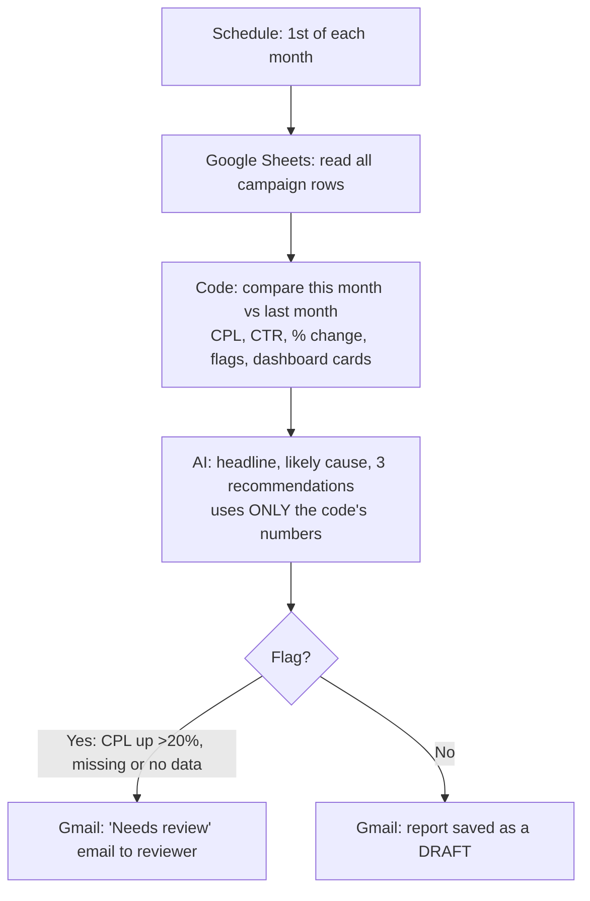
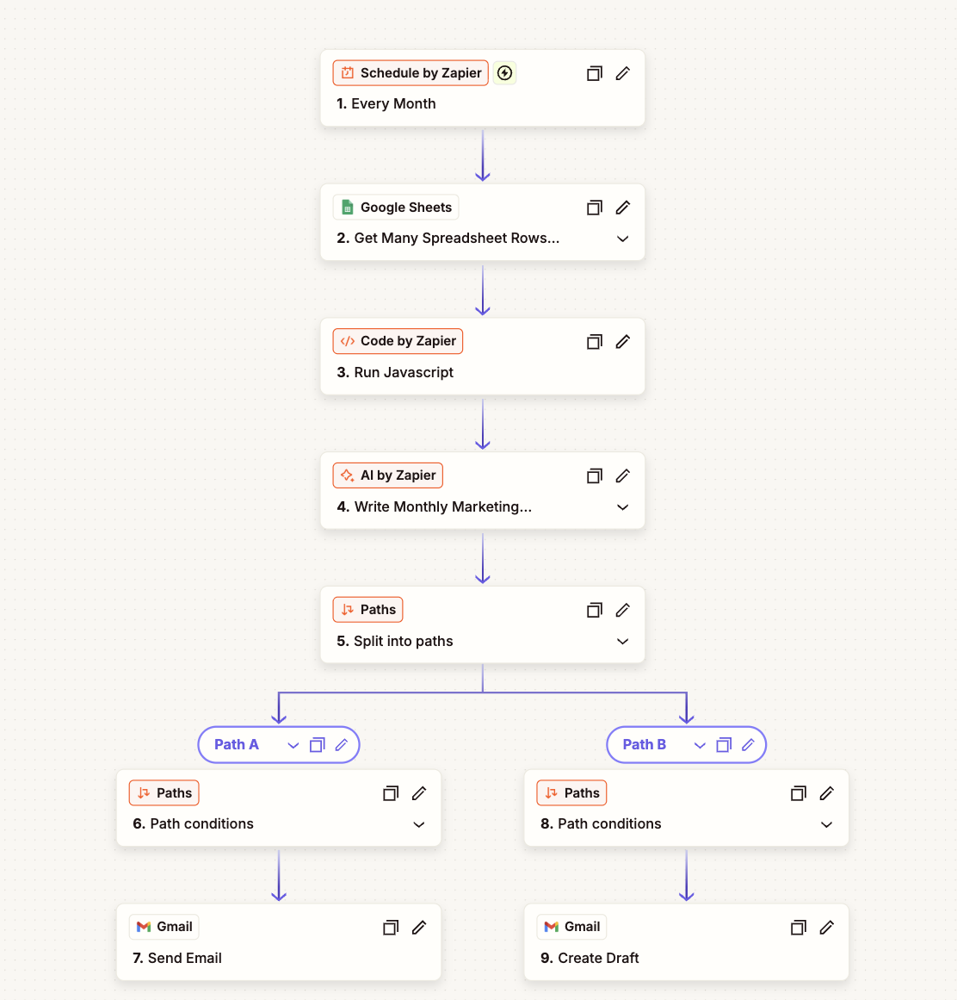
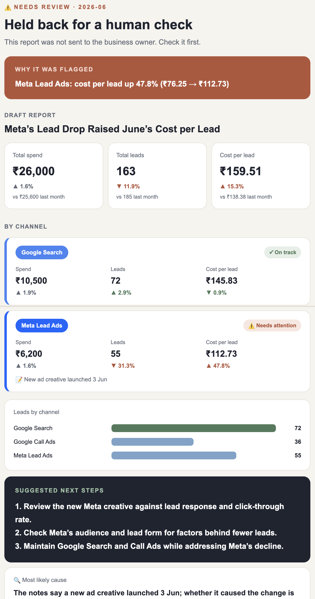

# Monthly Marketing Report Agent (Zapier)

An automation that turns a month of campaign data into a **plain-English report for a non-technical business owner**, without letting AI touch the numbers.

> **Independent portfolio project.** Not built for any company. All data is **fictional**.

---

## The idea in one line

**Code for numbers. AI for judgement. A human for accountability.**

| Job | Who does it | Why |
|---|---|---|
| Totals, cost per lead, % change, alerts, dashboard cards | **Code** (JavaScript) | Exact and repeatable. Code never "estimates". |
| Headline, likely cause, three recommendations | **AI** (AI by Zapier) | Wording and judgement, using only numbers the code supplies |
| Final send | **A person** | Flagged months go to review. Normal months become a Gmail draft, never sent automatically |

This carries over a lesson from my earlier n8n project (a review-reply agent), where AI-written replies leaked details until a code checker and human approval were added.

---

## How it works



**9 Zapier steps:** Schedule → Google Sheets (Get Many Rows, Advanced) → Code (JavaScript) → AI by Zapier → Paths → Path A: rule + Gmail Send · Path B: rule + Gmail Create Draft

---

## Safety rules built in

- **Missing is never zero.** A blank cell becomes `MISSING`, and totals become `INCOMPLETE`. The AI is told to say it's missing and give the reason from the notes.
- **Causes only come from the notes.** Otherwise the AI must say "unclear".
- **Automatic flags:** cost per lead up more than 20%, leads missing this month or last month, no data for the month.
- **Nothing reaches the owner automatically.** Even a clean month is only a draft.

---

## Screenshots

| Zap | "Needs review" email (June) |
|---|---|
|  |  |

The email dashboard (stat cards, ▲▼ arrows, brand-coloured channel pills, bar chart) is **built by the code**, so every figure on it is calculated rather than written by the AI. The arrow colour follows what's good for the business: lower cost per lead shows green, fewer leads shows red.

---

## Tested on four cases

| Test | Trap | Result |
|---|---|---|
| June vs May | Meta cost per lead +47.8% after a new creative | ✅ Flagged → review |
| April vs March | Google Search leads blank (tracking broken) | ✅ Reported as missing, nothing guessed → review |
| February vs January | Clean month | ✅ Draft only |
| October (automatic month) | No data in the sheet | ✅ "No data found" → review, no empty report |

Full log of problems and fixes: [`docs/what-broke.md`](docs/what-broke.md)

---

## Files

| Path | What it is |
|---|---|
| [`code/report-calculations.js`](code/report-calculations.js) | The Code by Zapier step: all calculations, flags and the email dashboard HTML |
| [`prompts/ai-report-prompt.md`](prompts/ai-report-prompt.md) | The AI prompt and how it changed during testing |
| [`email-templates/needs-review.html`](email-templates/needs-review.html) | Path A email |
| [`email-templates/report-draft.html`](email-templates/report-draft.html) | Path B draft |
| [`data/marketing_campaign_data.csv`](data/marketing_campaign_data.csv) | Fictional data: 6 months × 3 channels, with the test traps built in |
| [`docs/what-broke.md`](docs/what-broke.md) | Every error hit while building, and the fix |

---

## Run the calculations locally

The code expects Zapier's `inputData`. To try it in Node:

```js
const fs = require('fs');
const rows = fs.readFileSync('data/marketing_campaign_data.csv', 'utf8').trim().split('\n')
  .map(l => l.split(','));
const run = new Function('inputData', fs.readFileSync('code/report-calculations.js', 'utf8'));
const out = run({ rows_json: JSON.stringify(rows), report_month: '2026-06' });
console.log(out.flag, out.flag_reasons);
console.log(out.summary_text);
```

---

## Limits

- Built and tested on Zapier's 14-day Professional trial. Multi-step Zaps and Paths need a paid plan, so it is **not running monthly in production**.
- Three channels and one sheet. A real setup would pull from the ad platforms directly.

---

**Built by Nikhilesh Teli** · [LinkedIn](https://linkedin.com/in/tnik)
